<div align="center">


# YumeList

**Your anime & manga companion for MyAnimeList, rebuilt with Material 3 Expressive.**

[](https://github.com/Muhammedahmed18/YumeList/releases/latest)
[](https://github.com/Muhammedahmed18/YumeList/releases)
[](LICENSE)


[**Download**](https://github.com/Muhammedahmed18/YumeList/releases/latest) · [**What's new in 3.0.0**](https://github.com/Muhammedahmed18/YumeList/releases/tag/v3.0.0) · [**Report a bug**](https://github.com/Muhammedahmed18/YumeList/issues)

</div>

---

YumeList is an unofficial Android client for [MyAnimeList](https://myanimelist.net). Track what you watch and read, see what airs today, browse the season and dig into rankings, all in a clean, modern interface with full OLED black support.

> [!NOTE]
> YumeList is a fork of [**MoeList**](https://github.com/axiel7/MoeList) by [axiel7](https://github.com/axiel7). It has since become its own app: the UI has been redesigned, the networking layer rewritten and every dependency modernized. All credit for the original foundation goes to axiel7. See [Credits](#credits).

## Screenshots

<table>
  <tr>
    <th colspan="4">Onboarding</th>
  </tr>
  <tr>
    <td align="center">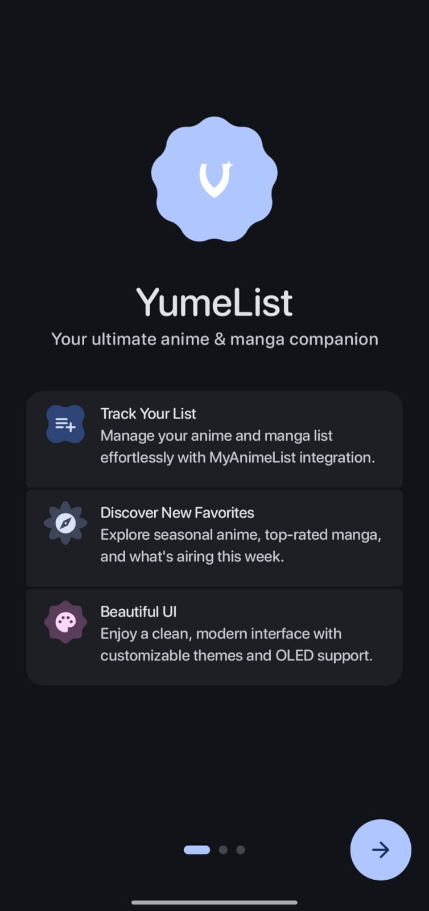<br/><sub>Welcome</sub></td>
    <td align="center">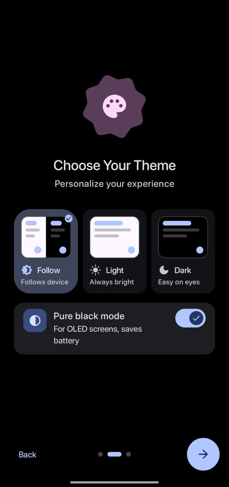<br/><sub>Choose your theme</sub></td>
    <td align="center">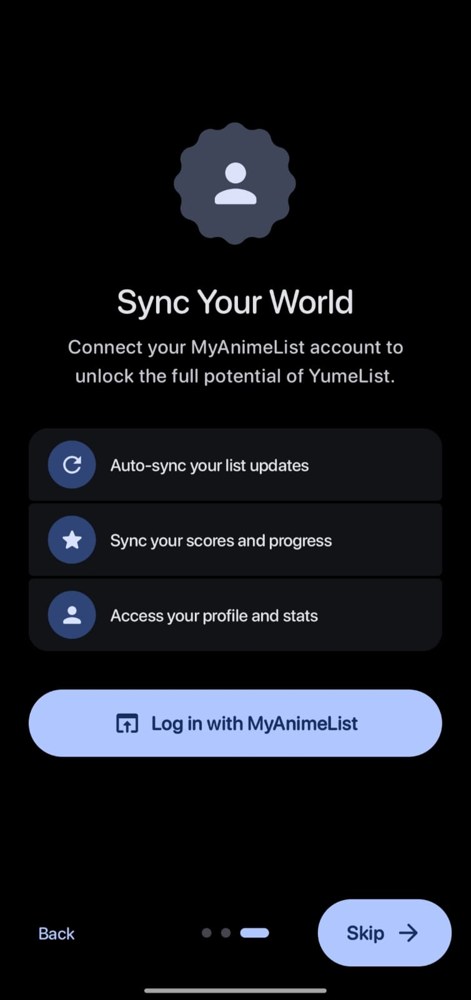<br/><sub>Sync with MyAnimeList</sub></td>
    <td></td>
  </tr>
  <tr>
    <th colspan="4">Your lists</th>
  </tr>
  <tr>
    <td align="center">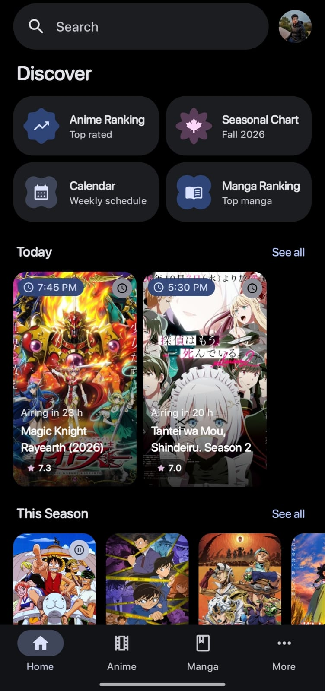<br/><sub>Home</sub></td>
    <td align="center">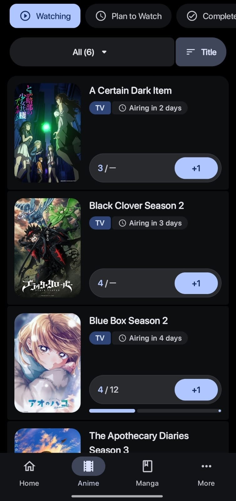<br/><sub>Anime list</sub></td>
    <td align="center">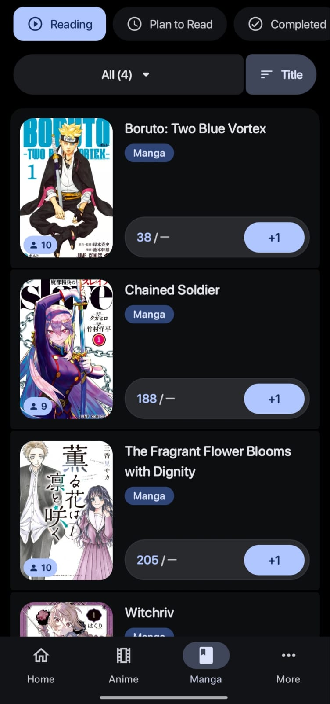<br/><sub>Manga list</sub></td>
    <td align="center">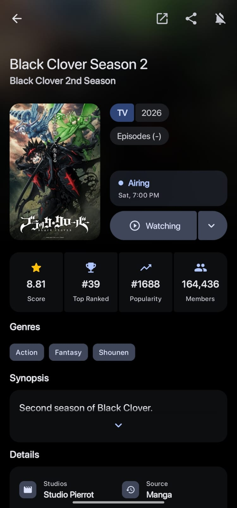<br/><sub>Details</sub></td>
  </tr>
  <tr>
    <th colspan="4">Discover</th>
  </tr>
  <tr>
    <td align="center">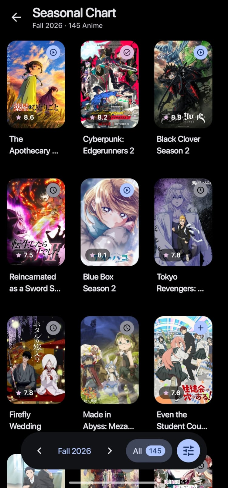<br/><sub>Seasonal chart</sub></td>
    <td align="center">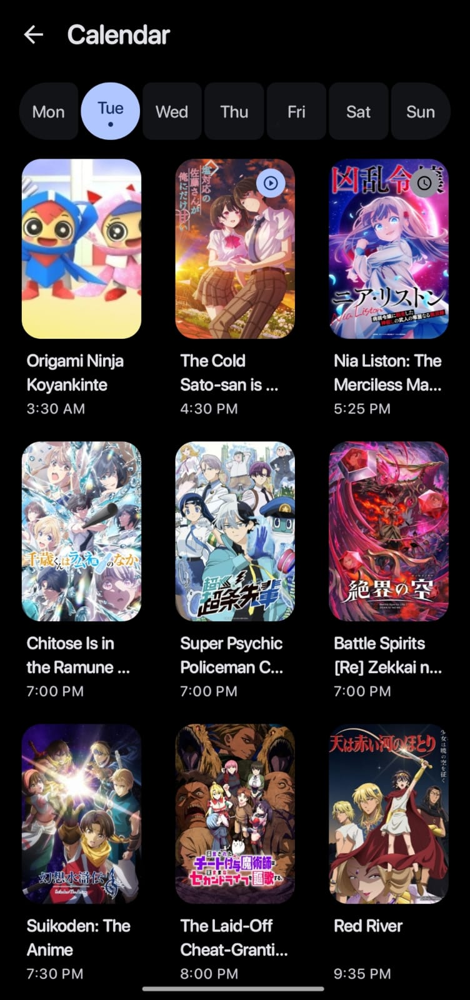<br/><sub>Calendar</sub></td>
    <td align="center">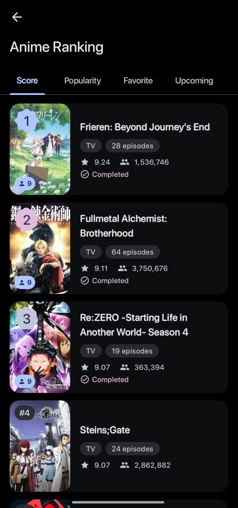<br/><sub>Anime ranking</sub></td>
    <td align="center">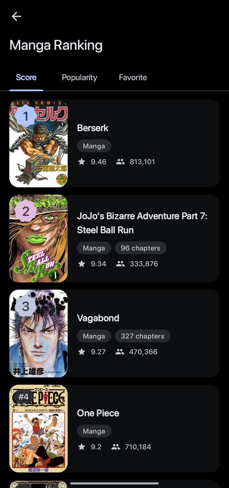<br/><sub>Manga ranking</sub></td>
  </tr>
</table>

## Features

**Track**
- Manage your anime and manga lists, synced with your MyAnimeList account
- One-tap **+1** progress buttons with progress bars
- "Airing in X days" countdowns on the shows you're watching
- Sort and filter your lists, with a choice of list styles
- Edit status, score, progress and dates from a single sheet

**Discover**
- **Today**: what's airing today, with broadcast times and live countdowns
- **Seasonal chart**: browse any season, with filters and a floating season switcher
- **Calendar**: the weekly airing schedule, one day at a time
- **Rankings**: top anime and manga by score, popularity and favorites, plus upcoming anime
- Search with history

**Details**
- Score, rank, popularity and member stat tiles
- Airing status with the next broadcast time
- Genres, synopsis, studios, source, characters, related titles and opening/ending themes
- Status distribution and manga statistics (via Jikan)

**Make it yours**
- Light, dark or follow-system themes, plus **pure black mode** for OLED screens
- Material 3 Expressive design with smooth shared-element transitions
- Choose your start tab and navigation layout, with tablet support (navigation rail)
- Title language and content preferences

**More**
- Airing notifications
- Home-screen airing widget
- Profile with your anime and manga stats

## Download

<p>
  <a href="https://rookieenough.github.io/Orion-Data/app/?id=yumelist"></a>
  <a href="https://github.com/Muhammedahmed18/YumeList/releases/latest"></a>
</p>

Get it from **[Orion Store](https://rookieenough.github.io/Orion-Data/app/?id=yumelist)** for automatic updates, or download the APK directly from **[GitHub Releases](https://github.com/Muhammedahmed18/YumeList/releases/latest)**.

| File | Choose it if… |
|---|---|
| `yumelist-v3.0.0-arm64-v8a-release.apk` | You have a modern phone (most devices from 2017 onward) |
| `yumelist-v3.0.0-armeabi-v7a-release.apk` | You have an older 32-bit phone |
| `yumelist-v3.0.0-x86_64-release.apk` / `x86` | You use an emulator or a Chromebook |
| `yumelist-v3.0.0-universal-release.apk` | You're not sure. It works everywhere, but it's bigger |

Requires **Android 7.0 (API 24)** or newer.

## Build from source

1. Clone the repo:
   ```bash
   git clone https://github.com/Muhammedahmed18/YumeList.git
   ```
2. Create a MyAnimeList API client at [myanimelist.net/apiconfig](https://myanimelist.net/apiconfig):
   - **App Type:** `android`
   - **Redirect URL:** `yume://callback`
3. Create a `private.properties` file in the project root:
   ```properties
   CLIENT_ID="your_mal_api_client_id"
   ```
4. Open the project in Android Studio and run it, or build from the command line:
   ```bash
   ./gradlew assembleRelease
   ```

## Tech stack

| | |
|---|---|
| **UI** | Jetpack Compose, Material 3 Expressive (1.5) |
| **Networking** | Retrofit 3, OkHttp 5, kotlinx.serialization |
| **APIs** | [MyAnimeList API v2](https://myanimelist.net/apiconfig/references/api/v2), [Jikan v4](https://jikan.moe) |
| **Images** | Coil 3 |
| **DI** | Koin |
| **Storage** | Room, DataStore |
| **Background** | WorkManager, Jetpack Glance (widget) |
| **Target** | compileSdk 37 · targetSdk 36 · minSdk 24 |

## Credits

- **[MoeList](https://github.com/axiel7/MoeList)** by [axiel7](https://github.com/axiel7), the original app YumeList is built on. If you like this app, consider [supporting axiel7](https://ko-fi.com/axiel7).
- Original MoeList contributors: [danielvd_art](https://instagram.com/danielvd_art) and [WSTxda](https://github.com/WSTxda) (MoeList logo design), [MaximilianGT500](https://github.com/MaximilianGT500), [Jeluchu](https://github.com/Jeluchu), [Glodanif](https://github.com/glodanif)
- [MyAnimeList](https://myanimelist.net) for the official API
- [Jikan](https://jikan.moe) for the unofficial MyAnimeList API

## License

YumeList is licensed under the **GNU General Public License v3.0**, the same license as MoeList. See [LICENSE](LICENSE).

> YumeList is not affiliated with or endorsed by MyAnimeList. All anime and manga artwork shown in the screenshots belongs to its respective owners.
